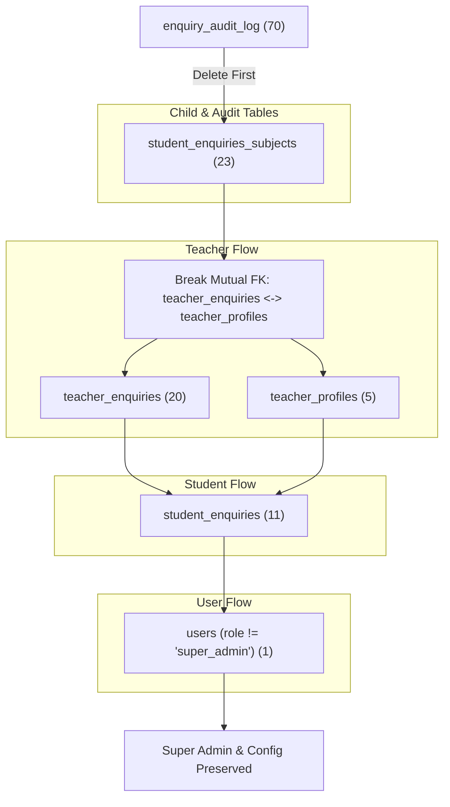

# Database Cleanup & Inspection Report — Wellfind Academic

**Date:** 2026-11-19  
**Database:** `wellfind-db` (PostgreSQL 17.12 via Docker container `common-postgres` on `127.0.0.1:5432`)  
**Scope:** Wellfind Academic (`wellfind-api`, `wellfind-client`, `wellfind-crm`)  
**Status:** Pre-Execution Inspection & Plan Ready (Awaiting User Authorization)

---

## 1. Executive Summary & Safety Pre-requisites

A comprehensive inspection of the entire database schema, table dependencies, and record counts was conducted. A full SQL dump backup has been taken and verified.

- **Verified Backup Location:** `wellfind-api/backups/wellfind-db-backup-pre-cleanup.sql` (Size: 314,558 bytes)
- **Total Tables in Public Schema:** 32 tables
- **Total Business/Test Records Targeted for Removal:** 130 records
- **Preserved Core Records:**
  - **Super Admin Accounts:** 2 accounts (`427rohit@gmail.com` [ID: 1] & `427rohitkumar@gmail.com` [ID: 94])
  - **Super Admin Sessions:** 5 active session records in `users_sessions`
  - **Global System Configuration:** 1 record in `teacher_evaluation_config`
  - **Database Migration State:** 1 record in `payload_migrations`
- **Destructive Deletion Status:** **HALTED / PENDING EXPLICIT USER APPROVAL**

---

## 2. Super Admin Account Identification & Protection Plan

The identification was performed **dynamically** using the authorization engine attribute `role === 'super_admin'`, without hardcoding email addresses:

| User ID | Email | Role | Account Status | Action |
|:---:|:---|:---:|:---:|:---:|
| **1** | `427rohit@gmail.com` | `super_admin` | `active` | **PRESERVE** |
| **94** | `427rohitkumar@gmail.com` | `super_admin` | `active` | **PRESERVE** |
| **35** | `teacher@wellfind.com` | `teacher` | `active` | **REMOVE** (Test teacher seed) |

### Super Admin Protection Guarantees:
1. **Zero Credential Modification:** Passwords (bcrypt hashes), salts, reset tokens, and security attributes remain 100% untouched.
2. **Session Preservation:** All 5 records in `users_sessions` belong exclusively to User 1 and User 94. They are preserved intact.
3. **Role & RBAC Invariant:** Role definitions and Payload CMS collection access rules (`access.admin`, `access.read`, `access.update`) remain unchanged.
4. **Live Verification:** Pre-cleanup authentication check against `POST /api/auth/login` confirmed 200 OK HTTP responses for both Super Admins.

---

## 3. Comprehensive Table-by-Table Inventory & Classification

| # | Table / Collection Name | Total Records | Test / Dummy Data | Preserved Records | Contains Super Admin Data? | Classification & Notes |
|:---:|:---|:---:|:---:|:---:|:---:|:---|
| 1 | `users` | 3 | 1 | 2 | **Yes** (IDs 1 & 94) | **Preserve Super Admins**, remove test teacher (ID 35) |
| 2 | `users_sessions` | 5 | 0 | 5 | **Yes** (Sessions for 1 & 94) | **Preserve** (All belong to Super Admins) |
| 3 | `teacher_evaluation_config` | 1 | 0 | 1 | No | **Preserve** (Global business config: weights 0.5/0.5) |
| 4 | `payload_migrations` | 1 | 0 | 1 | No | **Preserve** (Payload CMS migration state) |
| 5 | `payload_kv` | 0 | 0 | 0 | No | Empty |
| 6 | `payload_locked_documents` | 0 | 0 | 0 | No | Empty |
| 7 | `payload_locked_documents_rels` | 0 | 0 | 0 | No | Empty |
| 8 | `payload_preferences` | 0 | 0 | 0 | No | Empty |
| 9 | `payload_preferences_rels` | 0 | 0 | 0 | No | Empty |
| 10 | `media` | 0 | 0 | 0 | No | Empty |
| 11 | `student_enquiries` | 11 | 11 | 0 | No | **Remove** (Dummy website/seed enquiries) |
| 12 | `student_enquiries_subjects` | 23 | 23 | 0 | No | **Remove** (Child array entries of student_enquiries) |
| 13 | `students` | 0 | 0 | 0 | No | Empty |
| 14 | `students_subjects` | 0 | 0 | 0 | No | Empty |
| 15 | `student_assessments` | 0 | 0 | 0 | No | Empty |
| 16 | `student_assessments_strengths` | 0 | 0 | 0 | No | Empty |
| 17 | `student_assessments_weaknesses` | 0 | 0 | 0 | No | Empty |
| 18 | `student_tests` | 0 | 0 | 0 | No | Empty |
| 19 | `student_tests_assignment_history` | 0 | 0 | 0 | No | Empty |
| 20 | `student_test_payments` | 0 | 0 | 0 | No | Empty |
| 21 | `student_test_reports` | 0 | 0 | 0 | No | Empty |
| 22 | `student_test_reports_subject_results` | 0 | 0 | 0 | No | Empty |
| 23 | `student_test_report_shares` | 0 | 0 | 0 | No | Empty |
| 24 | `teacher_enquiries` | 20 | 20 | 0 | No | **Remove** (Dummy teacher applications) |
| 25 | `teacher_documents` | 0 | 0 | 0 | No | Empty |
| 26 | `teacher_evaluations` | 0 | 0 | 0 | No | Empty |
| 27 | `teacher_evaluations_revision_history` | 0 | 0 | 0 | No | Empty |
| 28 | `teacher_matches` | 0 | 0 | 0 | No | Empty |
| 29 | `teacher_allocations` | 0 | 0 | 0 | No | Empty |
| 30 | `teacher_allocations_status_history` | 0 | 0 | 0 | No | Empty |
| 31 | `teacher_profiles` | 5 | 5 | 0 | No | **Remove** (Sample teacher profile entries) |
| 32 | `enquiry_audit_log` | 70 | 70 | 0 | References Admin | **Remove** (Test status transition logs) |
| **Total** | **32 Tables** | **139** | **130** | **9** | — | **130 to Delete, 9 to Preserve** |

---

## 4. Foreign Key Relationships & Execution Sequence

Foreign key constraints in PostgreSQL require a strict acyclic deletion sequence to avoid constraint violation errors (`23503: foreign_key_violation`):

### Execution Steps (Wrapped in a Single Atomic Transaction):
1. `DELETE FROM enquiry_audit_log;` (70 rows)
2. `UPDATE teacher_enquiries SET teacher_profile_id = NULL;` (Clear circular FK)
3. `UPDATE teacher_profiles SET teacher_enquiry_id = NULL;` (Clear circular FK)
4. `DELETE FROM teacher_enquiries;` (20 rows)
5. `DELETE FROM teacher_profiles;` (5 rows)
6. `DELETE FROM student_enquiries_subjects;` (23 rows)
7. `DELETE FROM student_enquiries;` (11 rows)
8. `DELETE FROM users WHERE role != 'super_admin';` (1 row: User ID 35)
9. Verify counts: Total deleted = 130 rows, remaining rows = 9 (2 super admins, 5 sessions, 1 config, 1 migration).
10. `COMMIT;`

---

## 5. Dry-Run Verification

The dry-run script `wellfind-api/scripts/clean-database.mjs` was executed against `wellfind-db`.
- **Result:** Successfully simulated inside a transaction and rolled back (`ROLLBACK`).
- **No records were deleted or altered.**
- **Exit Code:** `0` (Clean run).
